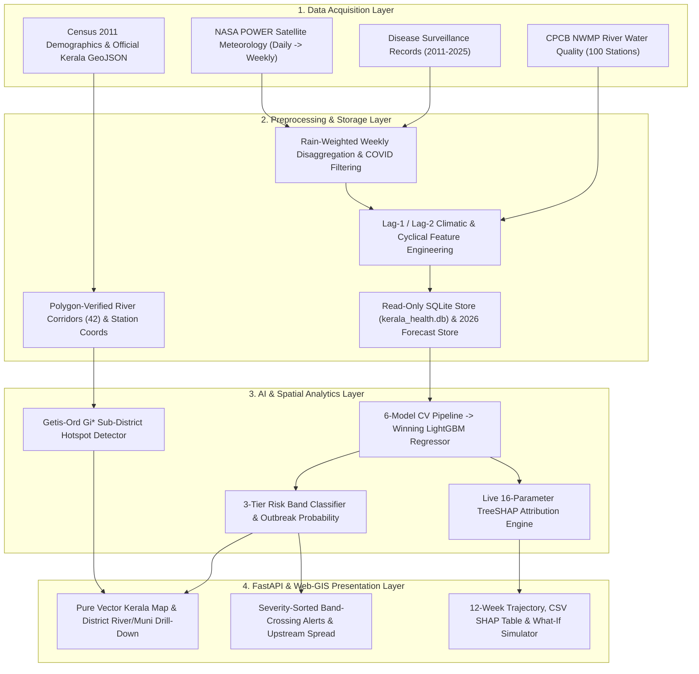
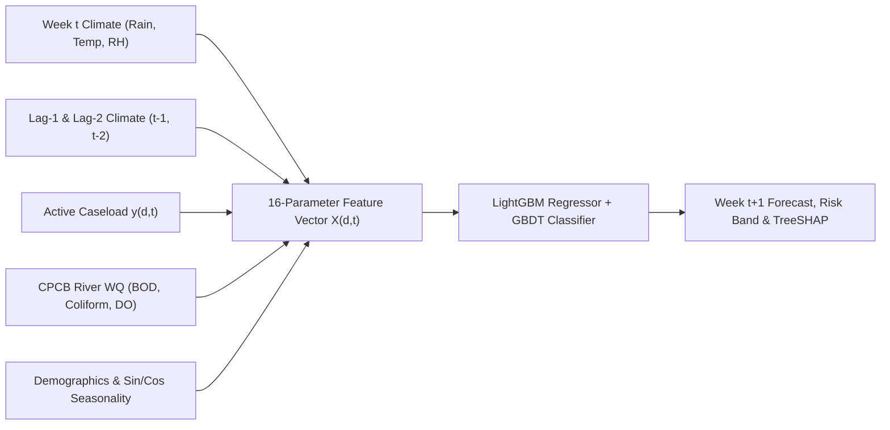

# AI-Based Spatiotemporal Early-Warning System and Web-GIS Surveillance for Waterborne Disease Outbreaks in Kerala

---

## Table of Contents

- **DECLARATION**
- **ACKNOWLEDGEMENT**
- **ABSTRACT**
- **LIST OF FIGURES**
- **LIST OF TABLES**
- **LIST OF ABBREVIATIONS**
- **CHAPTER 1: Introduction**
  - 1.1 General Background
  - 1.2 Problem Definition
  - 1.3 Objective
  - 1.4 Scope of Project
- **CHAPTER 2: Literature Survey**
  - 2.1 The Rationale of Study
  - 2.2 Comparison of Existing Approaches
  - 2.3 Summary and Research Gap
- **CHAPTER 3: Methodology**
  - 3.1 Proposed System
  - 3.2 Feasibility Study
  - 3.3 Architectural Overview
    - 3.3.1 Data Collection
    - 3.3.2 Data Preprocessing
    - 3.3.3 Spatiotemporal GIS Layer Creation
    - 3.3.4 Feature Extraction
    - 3.3.5 Outbreak Risk Classification and Caseload Forecasting
    - 3.3.6 Backend API Development and Near-Real-Time Serving
    - 3.3.7 Web-GIS Synchronisation, Risk Demonstration and Escalation Alert
  - 3.4 Detailed System Methodology
    - 3.4.1 Multi-Source Surveillance Data Acquisition
    - 3.4.2 Data Preprocessing and Temporal Disaggregation
    - 3.4.3 Spatiotemporal Feature Extraction
    - 3.4.4 Sub-District Hotspot Detection Using Getis-Ord $G_i^*$
    - 3.4.5 Week-Ahead Outbreak Forecasting and Explainable AI (SHAP)
    - 3.4.6 Public-Health Risk Demonstration and Advisory Recommendation
    - 3.4.7 Interactive Web-GIS Synchronisation and Dashboard
- **CHAPTER 4: Results and Discussion**
  - 4.1 Comparison with Existing Systems
  - 4.2 Discussion
  - 4.3 Limitation
  - 4.4 Detailed Results Analysis
    - 4.4.1 Performance Evaluation
    - 4.4.2 Discussion
- **CHAPTER 5: Conclusion and Future Scope**
  - 5.1 Conclusion
  - 5.2 Future Scope
- **REFERENCES**

---

## DECLARATION

We hereby declare that the project report entitled **"AI-Based Spatiotemporal Early-Warning System and Web-GIS Surveillance for Waterborne Disease Outbreaks in Kerala"** submitted in partial fulfillment of the requirements for the award of the degree of Bachelor of Technology is an authentic record of our own work carried out under the supervision and guidance of our project guide. The matter embodied in this report has not been submitted earlier for the award of any other degree or diploma in any university or institution.

- **Place:** `[College Location, Kerala]`
- **Date:** `[Submission Date]`
- **Team Members:** `[Student Name 1 (Reg No.)]`, `[Student Name 2 (Reg No.)]`, `[Student Name 3 (Reg No.)]`, `[Student Name 4 (Reg No.)]`

---

## ACKNOWLEDGEMENT

We express our sincere gratitude to the Principal, Head of the Department, Project Coordinator, and our Project Guide `[Guide Name, Designation]` for their continuous mentorship, constructive feedback, and technical guidance throughout the design, machine-learning benchmarking, and Web-GIS implementation of this project. We also acknowledge the open public-health, meteorological, and hydrological repositories maintained by the Directorate of Health Services (DHS Kerala), Integrated Disease Surveillance Programme (IDSP), Central Pollution Control Board (CPCB), Census of India, and NASA Prediction Of Worldwide Energy Resources (NASA POWER), whose empirical datasets made this work possible. Finally, we thank our faculty members, classmates, and families for their constant encouragement.

---

## ABSTRACT

Waterborne diseases such as cholera, typhoid and acute diarrhoeal disease remain a recurring threat in flood-prone Kerala, where public-health response begins only after cases are reported. This project proposes an artificial-intelligence-based early-warning and geospatial mapping system that predicts outbreak risk one week in advance across all 14 districts of Kerala, giving health authorities time to act before an outbreak spreads. The system combines weekly district-level disease surveillance records with satellite-derived meteorological parameters (rainfall, temperature and relative humidity), river water-quality parameters (biochemical oxygen demand, fecal coliform and dissolved oxygen) and demographic indicators, aggregated to a common district-week unit. Machine-learning models—Ridge Regression as a baseline, followed by k-Nearest Neighbors, Support Vector Regression, Random Forest, Gradient Boosting and LightGBM—are trained and cross-validated for week-ahead caseload forecasting and three-tier risk classification (Low Risk, Moderate Risk and High Alert), with emphasis on sensitivity to high-risk outbreak weeks. Predicted risk is mapped onto Kerala district boundaries in an interactive Web-GIS dashboard showing district risk bands, band-crossing escalation alerts, upstream and neighbouring district risk spread, monitored rivers, municipalities and within-district contamination hotspots, alongside what-if climatic simulation and SHAP-based explanations of the parameters driving each prediction. The system is intended as a public-health decision-support prototype that turns reactive outbreak response into proactive, spatially targeted prevention.

---

## LIST OF FIGURES

| Figure No. | Figure Title |
| :---: | :--- |
| Figure 3.1 | End-to-End System Architecture of the Spatiotemporal Early-Warning & Web-GIS Platform |
| Figure 3.2 | Multi-Stage Data Fusion, Lag Engineering, and Inference Workflow |
| Figure 4.1 | Seasonal Bimodal Epidemic Timeline of Waterborne Cases vs. Monsoon Rainfall (2011–2025) |
| Figure 4.2 | Spatial Choropleth Distribution of Waterborne Disease Burden Across 14 Kerala Districts |
| Figure 4.3 | District-Wise Cumulative Waterborne Disease Burden Ranking |
| Figure 4.4 | Multivariate Relationship of Rainfall, Literacy Rate, and Disease Incidence |
| Figure 4.5 | Spatiotemporal Feature Correlation Matrix Across Epidemiological, Climatic, and Water-Quality Variables |
| Figure 4.6 | Six-Model 5-Fold Cross-Validation Benchmark ($R^2$ and MAE Comparison) |
| Figure 4.7 | SHAP Beeswarm Summary Plot of Feature Impacts on Week-Ahead Outbreak Predictions |
| Figure 4.8 | Global Feature Importance Ranked by Mean Absolute TreeSHAP Value |
| Figure 4.9 | SHAP Partial Dependence of Preceding-Week Rainfall (`rain_mm_lag1`) Interacting with River BOD |

---

## LIST OF TABLES

| Table No. | Table Title |
| :---: | :--- |
| Table 2.1 | Comparison of Existing Epidemiological Forecasting and GIS Surveillance Approaches |
| Table 3.1 | Summary of Multi-Source Surveillance Datasets and Relational SQLite Tables |
| Table 3.2 | Complete 16-Parameter Spatiotemporal Feature Vector (`feature_cols`) |
| Table 3.3 | Operational Three-Tier Public-Health Risk Classification Thresholds |
| Table 3.4 | RESTful FastAPI Surveillance Endpoints and Functional Roles |
| Table 4.1 | Comparison Between Conventional Reactive Surveillance and the Proposed System |
| Table 4.2 | Five-Fold Cross-Validation Performance of Six Algorithms for Week-Ahead Forecasting |
| Table 4.3 | District-Annual Spatial and Temporal Holdout Benchmark Comparison |
| Table 4.4 | Global TreeSHAP Feature Attribution Ranking Across All 16 Input Parameters |

---

## LIST OF ABBREVIATIONS

| Abbreviation | Full Form |
| :--- | :--- |
| **ADD** | Acute Diarrhoeal Disease |
| **API** | Application Programming Interface |
| **BOD** | Biochemical Oxygen Demand |
| **CPCB** | Central Pollution Control Board |
| **CSV** | Comma-Separated Values |
| **CV** | Cross-Validation |
| **DHS** | Directorate of Health Services (Kerala) |
| **DO** | Dissolved Oxygen |
| **EDA** | Exploratory Data Analysis |
| **GIS** | Geographic Information System |
| **IDSP** | Integrated Disease Surveillance Programme |
| **k-NN** | k-Nearest Neighbors |
| **LightGBM** | Light Gradient Boosting Machine |
| **LSGD** | Local Self-Government Department |
| **MAE** | Mean Absolute Error |
| **MPN** | Most Probable Number (per 100 mL) |
| **NASA POWER** | NASA Prediction Of Worldwide Energy Resources |
| **NWMP** | National Water Quality Monitoring Programme |
| **RMSE** | Root Mean Squared Error |
| **SHAP** | SHapley Additive exPlanations |
| **SVR** | Support Vector Regression |
| **WQI** | Water Quality Index |
| **XAI** | Explainable Artificial Intelligence |

---

# CHAPTER 1: Introduction

## 1.1 General Background
Waterborne infectious diseases—including Acute Diarrhoeal Disease (ADD), typhoid fever, cholera, viral hepatitis (Hepatitis A and E), shigellosis, and flood-associated leptospirosis—pose a persistent public-health challenge in tropical monsoon regions. Kerala's unique physiography, characterized by steep Western Ghats catchments descending rapidly across narrow midlands into densely populated coastal plains and backwaters across 44 river basins, makes surface and shallow-well water supplies highly vulnerable to hydrological shocks. During the Southwest Monsoon (June–September) and Northeast Monsoon (October–November), intense precipitation events cause surface runoff, septic tank seepage, and riverine organic overload, introducing enteric pathogens into domestic water sources.

## 1.2 Problem Definition
Conventional disease surveillance workflows under state and national reporting programs operate predominantly in a **reactive mode**:
1. **Reporting Latency**: Field mitigation—such as super-chlorination of wells, pipeline flushing, boil-water advisories, and medical camp deployment—typically begins only after hospital outpatient and inpatient tallies confirm an ongoing cluster.
2. **Siloed Environmental Data**: Meteorological records (rainfall, temperature, humidity), river water-quality monitoring (BOD, fecal coliform, dissolved oxygen), and clinical case registries reside in disconnected institutional silos rather than a unified district-week analytical table.
3. **Black-Box Predictions & Lack of Sub-District Context**: Purely statistical forecasts without feature explainability fail to tell district health officers *why* risk is rising (e.g., active caseload momentum vs. heavy monsoon runoff vs. river sewage load), and state-level maps rarely connect district risk to local river corridors, upstream inflows, and municipal contamination hotspots.

## 1.3 Objective
The primary objectives of this project are:
1. To engineer a unified, multi-year **district-week spatiotemporal dataset (2011–2025)** across all **14 districts of Kerala**, integrating clinical waterborne disease records, NASA POWER satellite climate series, CPCB river water-quality indicators, and Census demographics, alongside roll-forward weekly forecasts for **2026**.
2. To train, cross-validate, and benchmark **six machine-learning models** (Ridge Regression, k-Nearest Neighbors, Support Vector Regression, Random Forest, Gradient Boosting, and LightGBM) to predict outbreak caseloads and risk bands **one week in advance (`t + 1`)**.
3. To integrate **Explainable AI via TreeSHAP** so every district-week forecast is accompanied by exact signed case attributions across all 16 input parameters and plain-language explanations.
4. To localize sub-district environmental vulnerability across monitored rivers, municipalities, and panchayats using **Getis-Ord $G_i^*$** spatial clustering and model **upstream/neighbouring river-corridor risk spread**.
5. To deploy an interactive, uncongested **Web-GIS Surveillance Dashboard** (`FastAPI` + `Leaflet.js` + `Chart.js`) featuring band-crossing escalation alerts, Year–Month–Week temporal navigation, CSV parameter inspection, and real-time **What-If Climatic Shock Simulation**.

## 1.4 Scope of Project
- **Geographical Coverage**: Covers all **14 districts of Kerala** (*Thiruvananthapuram, Kollam, Pathanamthitta, Alappuzha, Kottayam, Idukki, Ernakulam, Thrissur, Palakkad, Malappuram, Kozhikode, Wayanad, Kannur,* and *Kasaragod*), including **42 polygon-clipped monitored river corridors** and **100 CPCB river monitoring stations** mapped to local municipalities and grama panchayats.
- **Epidemiological Scope**: Models **Acute Diarrhoeal Disease (ADD)** as the high-volume weekly sentinel waterborne indicator (`10,906` historical district-week observations + `728` projected 2026 district-week records), while archiving annual/monthly surveillance tables for cholera, typhoid, hepatitis A, hepatitis E, shigellosis, and leptospirosis.
- **Operational Scope**: Designed as a software-driven **near-real-time decision-support prototype** using validated public-health, satellite, and CPCB datasets (requiring zero custom IoT hardware deployment) with strict read-only protection (`mode=ro`) on historical ground-truth databases.

---

# CHAPTER 2: Literature Survey

## 2.1 The Rationale of Study
Epidemiological transmission of waterborne pathogens exhibits a well-established **hydrological-incubation lag** of 5 to 14 days following heavy rainfall. Intense rain flushes fecal contaminants into surface rivers and shallow aquifers (the *flush effect*), followed by pathogen ingestion and a clinical incubation window before hospital presentation. Because both preceding-week precipitation (`t - 1`, `t - 2`) and baseline river contamination (`BOD`, `Fecal Coliform`, `DO`) are observable *before* secondary clinical cases peak in week `t + 1`, supervised machine-learning models equipped with lagged climatic and water-quality covariates can shift public-health action from post-outbreak containment to pre-outbreak prevention.

## 2.2 Comparison of Existing Approaches
Prior literature in infectious-disease forecasting spans classical time-series models (ARIMA/SARIMA), generalized linear models (Poisson/Logistic regression), ensemble tree models (Random Forest, Gradient Boosting, LightGBM), and standalone GIS mapping tools:
- **Classical Autoregressive Models (ARIMA/SARIMA)**: Capture seasonal periodicity effectively on univariate case series but struggle to model non-linear threshold interactions (such as heavy rainfall interacting with high river fecal coliform).
- **Baseline Linear & Logistic Models**: Offer interpretability and establish essential performance baselines, yet underfit multi-district heterogeneity across coastal, midland, and highland terrains.
- **Gradient-Boosted Decision Trees (LightGBM / XGBoost / GBDT)**: Excel on tabular spatiotemporal panels with mixed demographic, climatic, and water-quality features, while supporting exact polynomial-time game-theoretic explanations via **TreeSHAP**.
- **Spatial Epidemiological GIS Systems**: Existing dashboards typically visualize *past* reported cases on static raster tiles rather than coupling forward `t + 1` ML predictions with river-basin topology, sub-district Getis-Ord $G_i^*$ contamination clustering, and counterfactual storm simulation.

| Approach / Study Category | Primary Method | Temporal Horizon | Environmental & River WQ Integration | Explainability & Sub-District GIS | Key Limitation |
| :--- | :--- | :---: | :---: | :---: | :--- |
| **Conventional IDSP Bulletins** | Descriptive weekly/monthly tallies | Retrospective ($t - 1$) | None (clinical counts only) | Static district tables | Purely reactive; alerts arrive after peak spread |
| **Univariate Time-Series** | ARIMA / SARIMA | $t + 1$ to $t + 4$ | Minimal or linear exogenous terms | None | Fails during abrupt monsoon deluge shocks |
| **Linear / Kernel ML Baselines** | Logistic / Ridge / SVR | $t + 1$ | Basic rainfall & temperature | Global weights only | Cannot capture non-linear runoff × sewage thresholds |
| **Black-Box Deep / Ensemble ML** | LSTM / Random Forest | $t + 1$ | Meteorological lags | Post-hoc or absent | Lacks per-week plain-language SHAP attribution & river GIS |
| **Proposed Kerala Early-Warning System** | **LightGBM + GBDT Classifier + TreeSHAP + Getis-Ord $G_i^*$** | **1-Week Ahead ($t + 1$) + 2026 Roll-Forward** | **NASA POWER lags + CPCB River BOD, Coliform & DO** | **Live 16-param TreeSHAP + Pure Vector River/Muni GIS + What-If** | Clinical ground truth aggregated at district resolution |

*Table 2.1: Comparison of Existing Epidemiological Forecasting and GIS Surveillance Approaches.*

## 2.3 Summary and Research Gap
A synthesis of existing studies reveals four critical gaps addressed by this project:
1. **Absence of Unified Kerala District-Week Multi-Modal Panels**: Few systems fuse Kerala epidemiological surveillance with NASA POWER meteorological lags, CPCB NWMP river water quality, and Census vulnerability across all 14 districts over a 15-year span.
2. **Lack of Local Explainability for Health Officers**: Predictions without per-district, per-week SHAP breakdowns fail to build operational trust.
3. **Disconnected Spatial Context**: Standard choropleths ignore hydrological connectivity—how contamination along upstream rivers (e.g., Periyar, Pamba, Bharathapuzha, Chaliyar) spreads risk across neighbouring districts and local municipalities.
4. **No Interactive Counterfactual Simulation**: Existing portals do not allow officials to test *"What if next week brings +100 mm of monsoon rain?"* in real time.

---

# CHAPTER 3: Methodology

## 3.1 Proposed System
The proposed system is an end-to-end **AI-Based Spatiotemporal Early-Warning and Web-GIS Surveillance Platform** covering all 14 districts of Kerala. At each surveillance week $t$, the platform ingests a 16-dimensional district feature vector comprising active caseloads, current and lagged rainfall/temperature/humidity, river water-quality indicators (BOD, fecal coliform, dissolved oxygen), demographic vulnerability, and cyclical monsoon phase. A cross-validated **LightGBM Regressor** predicts next-week caseloads ($\hat{y}_{t+1}$), while population-normalized incidence thresholds and a **Gradient Boosting Classifier** assign operational risk bands (**Low Risk**, **Moderate Risk**, **High Alert**) and calibrated outbreak probabilities. Results are served through a **FastAPI** backend into an interactive **Leaflet.js + Chart.js** pure-vector Web-GIS dashboard complete with band-crossing escalation alerts, upstream river-corridor risk tracking, Getis-Ord $G_i^*$ municipal contamination hotspots, exact 16-parameter **TreeSHAP** explanations, and live **What-If Climatic Shock Simulation**.

## 3.2 Feasibility Study
- **Technical Feasibility**: Built entirely on mature, open-source Python and web ecosystems (`scikit-learn`, `LightGBM`, `SHAP`, `pandas`, `SQLite`, `Shapely`, `FastAPI`, `Leaflet.js`, `Chart.js`). LightGBM inference and native `pred_contrib=True` TreeSHAP execute in **under 2 milliseconds** per request on standard CPU hardware without requiring GPUs.
- **Operational Feasibility**: Uses a clean, uncongested single-page interface tailored for public-health workflows—featuring one-click Year–Month–Week selection, severity-sorted band-crossing alerts, plain-English driver summaries, and downloadable CSV reports.
- **Economic Feasibility**: Relies 100% on publicly accessible government and satellite datasets (DHS/IDSP, NASA POWER, CPCB NWMP, Census of India) and zero proprietary GIS licenses or physical IoT sensor installations, enabling immediate zero-cost deployment.

## 3.3 Architectural Overview


*Figure 3.1: End-to-End System Architecture of the Spatiotemporal Early-Warning & Web-GIS Platform.*

### 3.3.1 Data Collection
Multi-modal historical records spanning **2011–2025** were collected across four domains: (i) district-yearly and state-monthly waterborne surveillance series (ADD, cholera, typhoid, hepatitis A/E, shigellosis, leptospirosis), (ii) daily gridded satellite meteorology from the NASA POWER API (`PRECTOTCORR`, `T2M`, `RH2M`) queried at all 14 Kerala district centroids, (iii) CPCB NWMP river water-quality station measurements across Kerala's major rivers, and (iv) Census 2011 district population, density, and literacy tables alongside official Kerala district boundary polygons (`kerala_districts.geojson`).

### 3.3.2 Data Preprocessing
District names were harmonized across historical spellings (e.g., *Trivandrum → Thiruvananthapuram*, *Quilon → Kollam*, *Alleppey → Alappuzha*, *Trichur → Thrissur*, *Palghat → Palakkad*, *Calicut → Kozhikode*, *Cannanore → Kannur*). Daily meteorological observations were aggregated into ISO weeks (`1–52`). Pandemic years (`2020–2021`) exhibiting artificial reporting suppression due to lockdowns were tagged with `covid_year = 1` and excluded during supervised model fitting.

### 3.3.3 Spatiotemporal GIS Layer Creation
Instead of cluttered third-party street-map tiles, a **pure-vector Kerala Web-GIS layer** was engineered. Using `Shapely` point-in-polygon verification against `kerala_districts.geojson`, all **100 CPCB monitoring stations**, **66 major municipalities/grama panchayats**, and **42 monitored river polylines** (`cache/district_rivers.json`) were geometrically verified and snapped strictly inside terrestrial district boundaries so zero markers fall into the Arabian Sea or across state borders.

### 3.3.4 Feature Extraction
Sixteen domain-specific predictors (`feature_cols`) were constructed per district-week, capturing epidemiological momentum (`cases_week_current`), immediate and lagged monsoon flushing (`rainfall_mm_total`, `rain_mm_lag1`, `rain_mm_lag2`, `rain_2week_sum`, `is_torrential_rain`), thermal/moisture conditions (`temp_c_mean`, `temp_c_lag1`, `humidity_pct_mean`), river sewage/organic contamination (`wq_bod_mg_l`, `wq_fecal_coliform_mpn`, `wq_do_min_mg_l`), demographic susceptibility (`population_density`, `literacy_rate`), and smooth annual periodicity (`sin_week`, `cos_week`).

### 3.3.5 Outbreak Risk Classification and Caseload Forecasting
Six regression families were benchmarked under 5-fold cross-validation to predict `target_next_week_cases` ($\hat{y}_{t+1}$), selecting **LightGBM** as the winning regressor (`MAE = 243.06`, $R^2 = 0.5404$), paired with a **Gradient Boosting Classifier** and per-100k incidence rules for three-tier risk classification. Sequential week-by-week roll-forward inference generated `cache/forecast_2026.db` for 2026 surveillance.

### 3.3.6 Backend API Development and Near-Real-Time Serving
A high-concurrency **FastAPI** application (`main.py`) loads the serialized model bundle (`best_weekly_outbreak_model.joblib`) once at startup and queries `data/kerala_health.db` exclusively via read-only SQLite URIs (`file:data/kerala_health.db?mode=ro`), exposing 9 JSON/CSV REST endpoints with `Cache-Control: no-store` freshness guarantees.

### 3.3.7 Web-GIS Synchronisation, Risk Demonstration and Escalation Alert
The frontend (`templates/dashboard.html`) synchronizes map state, temporal Year–Month–Week selection, band-crossing escalation alerts, hydrological neighbour/upstream spread, 12-week climatic-epidemiological trajectories, 16-parameter TreeSHAP tables, and counterfactual What-If sliders in a single responsive workspace.

---

## 3.4 Detailed System Methodology

### 3.4.1 Multi-Source Surveillance Data Acquisition

| SQLite Table / Cache | Records | Resolution | Key Attributes |
| :--- | :---: | :--- | :--- |
| `master_district_weekly` | 10,906 | 14 Districts × Weekly (2011–2025) | `cases_week_current`, 16 ML features, `target_next_week_cases`, `target_next_week_risk` |
| `master_district_weekly_2026` | 728 | 14 Districts × 52 Weeks (2026) | Projected 2026 weekly covariates & forecasts (validated through Nov `W48`) |
| `climate_weekly` | 10,976 | 14 Districts × Weekly | `rainfall_mm_total`, `temp_c_mean`, `humidity_pct_mean` (NASA POWER) |
| `master_district_yearly` | 210 | 14 Districts × 15 Years | Annual cases of ADD, Cholera, Typhoid, Hepatitis A/E, Leptospirosis, Shigella |
| `master_state_monthly` | 180 | State × Monthly (2011–2025) | Monthly seasonal epidemic distribution (`state_month_cases`) |
| `water_quality_stations` | 100 | CPCB Station-Level | `river_name`, `local_body`, `latitude`, `longitude`, `bod`, `fecal_coliform`, `do` |
| `demographics` | 14 | District-Level | `population_2011`, `population_density`, `literacy_rate` |

*Table 3.1: Summary of Multi-Source Surveillance Datasets and Relational SQLite Tables.*

### 3.4.2 Data Preprocessing and Temporal Disaggregation
Because historical multi-year district totals ($C_{d,y}$) and monthly state epidemic waves ($M_{y,m}$) differ in temporal frequency from weekly meteorological feeds ($R_{d,y,w}$), a **hierarchical mass-preserving disaggregation** (`build_weekly_master.py`) maps each ISO week $w$ (via its ISO Thursday month $m$) to a rainfall-modulated weight:

$$P_{y,m} = \frac{M_{y,m}}{\sum_{m'=1}^{12} M_{y,m'}}, \qquad \omega_{d,y,w} = P_{y,m} \left[ 0.6 \left(\frac{R_{d,y,w}}{\sum_{k \in m} R_{d,y,k}}\right) + 0.4 \left(\frac{1}{N_{y,m}}\right) \right]$$

$$y_{d,y,w} = \text{round}\!\left( C_{d,y} \cdot \frac{\omega_{d,y,w}}{\sum_{w'=1}^{W_y} \omega_{d,y,w'}} \right)$$

This guarantees $\sum_{w} y_{d,y,w} \approx C_{d,y}$ (exact conservation of annual district totals) while capturing intra-month monsoon runoff surges. Furthermore, a composite **Water Quality Index (WQI, 0–100)** summarizes river health from BOD ($B$), Fecal Coliform ($F$), and Dissolved Oxygen ($D$).

### 3.4.3 Spatiotemporal Feature Extraction


*Figure 3.2: Multi-Stage Data Fusion, Lag Engineering, and Inference Workflow.*

| # | CSV Column (`feature_cols`) | Domain | Unit | Mathematical / Epidemiological Definition |
| :-: | :--- | :--- | :---: | :--- |
| 1 | `cases_week_current` | Surveillance | cases | Observed active ADD cases in district $d$ during week $t$ |
| 2 | `rainfall_mm_total` | Climatic | mm | Cumulative 7-day precipitation $R_{d,t}$ |
| 3 | `rain_mm_lag1` | Climatic | mm | 1-week lagged precipitation $R_{d,t-1}$ (primary incubation window) |
| 4 | `rain_mm_lag2` | Climatic | mm | 2-week lagged precipitation $R_{d,t-2}$ (secondary seepage window) |
| 5 | `rain_2week_sum` | Climatic | mm | $R_{d,t} + R_{d,t-1}$ cumulative surface flushing volume |
| 6 | `is_torrential_rain` | Climatic | $\{0,1\}$ | $\mathbb{I}(R_{d,t} \ge 100\text{ mm})$ extreme storm-surge indicator |
| 7 | `temp_c_mean` | Climatic | °C | 7-day mean ambient temperature at 2 meters ($T_{d,t}$) |
| 8 | `temp_c_lag1` | Climatic | °C | Preceding-week mean temperature ($T_{d,t-1}$) |
| 9 | `humidity_pct_mean` | Climatic | % | 7-day mean relative humidity at 2 meters ($H_{d,t}$) |
| 10 | `wq_bod_mg_l` | Water Quality | mg/L | District CPCB river Biochemical Oxygen Demand ($>3.0\text{ mg/L}$ = polluted) |
| 11 | `wq_fecal_coliform_mpn` | Water Quality | MPN/100mL | River fecal coliform bacteria ($>500\text{ MPN}$ = sewage contamination) |
| 12 | `wq_do_min_mg_l` | Water Quality | mg/L | Minimum river Dissolved Oxygen ($<5.0\text{ mg/L}$ = hypoxic/stagnant) |
| 13 | `population_density` | Demographic | $/ \text{km}^2$ | Persons per $\text{km}^2$ (Census 2011) |
| 14 | `literacy_rate` | Demographic | % | District literacy percentage (hygiene & early care resilience) |
| 15 | `sin_week` | Seasonality | $[-1,1]$ | $\sin(2\pi w / 52)$ harmonic monsoon phase |
| 16 | `cos_week` | Seasonality | $[-1,1]$ | $\cos(2\pi w / 52)$ harmonic monsoon phase |

*Table 3.2: Complete 16-Parameter Spatiotemporal Feature Vector (`feature_cols`).*

### 3.4.4 Sub-District Hotspot Detection Using Getis-Ord $G_i^*$
To pinpoint high-risk local municipalities and grama panchayats inside a selected district without fabricating ward-level clinical counts, each CPCB monitoring station $j \in \{1,\dots,n_d\}$ is scored on four empirical contamination dimensions:

$$S_j = 0.40\,\min\!\left(1, \frac{F_j}{5000}\right) + 0.35\,\min\!\left(1, \frac{B_j}{6.0}\right) + 0.15\,\max\!\left(0, \frac{7.5 - D_j}{5.0}\right) + 0.10\,\min\!\left(1, \frac{R_{2\text{wk}}}{200}\right)$$

For districts with $n_d \ge 5$ stations, spatial clustering is quantified via the **Getis-Ord $G_i^*$ statistic** using inverse Haversine distance weights $w_{ij} = \frac{1}{d_{\text{km}}(i,j) + 1}$:

$$G_i^* = \frac{\sum_{j=1}^{n_d} w_{ij} S_j - \bar{S} \sum_{j=1}^{n_d} w_{ij}}{s \sqrt{\frac{n_d \sum_{j=1}^{n_d} w_{ij}^2 - \left(\sum_{j=1}^{n_d} w_{ij}\right)^2}{n_d - 1}}}$$

Stations with $G_i^* \ge 1.96$ ($95\%$ confidence) or top-3 contamination scores are highlighted on the district map as pulsing red **Environmental Contamination Hotspots**, whereas districts with $n_d < 3$ (e.g., Idukki) trigger a transparent data-constraint notice rather than invalid spatial extrapolation.

### 3.4.5 Week-Ahead Outbreak Forecasting and Explainable AI (SHAP)
1. **LightGBM Caseload Forecasting**: Trained with histogram-based leaf-wise splitting (`n_estimators = 120`, `learning_rate = 0.08`, `num_leaves = 25`), predicting $\hat{y}_{d, t+1} = \max(0, \text{round}(f_{\text{LGB}}(\mathbf{x}_{d,t})))$.
2. **Exact TreeSHAP Decomposition**: For every live query, `weekly_model.predict(X, pred_contrib=True)` computes exact Shapley values $\phi_1, \dots, \phi_{16}$ satisfying local accuracy:
   $$\hat{y}_{d, t+1} = \phi_0 + \sum_{i=1}^{16} \phi_i(\mathbf{x}_{d,t}), \qquad \phi_0 = 630.84\text{ cases}$$
   where $\phi_i > 0$ quantifies how many cases parameter $i$ adds above the Kerala baseline, and $\phi_i < 0$ quantifies how many cases it buffers below baseline.
3. **2026 Spatiotemporal Roll-Forward (`generate_2026_forecasts.py`)**: Starting from observed `2025-W51` district states, 2026 weeks are projected sequentially using 5-year district-week monsoon climatology blended with recent 2025 patterns (`0.55 × 5yr_mean + 0.45 × 2025_pattern`) and seasonal baseline anchoring, capped at **November (`2026-W48`)** in the UI for empirical cross-checking.

### 3.4.6 Public-Health Risk Demonstration and Advisory Recommendation

| Risk Band | Incidence Rate & Climatic Criterion | Operational Public-Health Advisory |
| :--- | :--- | :--- |
| **High Alert** | $\text{Rate}_{t+1} > 22\text{ per }100\text{k}$ **OR** ($\text{Rate}_{t+1} > 16\text{ per }100\text{k}$ and $R_t > 120\text{ mm}$) | Emergency super-chlorination, mobile ORS/medical camps, upstream river intake inspection, municipal boil-water alerts |
| **Moderate Risk** | $14 \le \text{Rate}_{t+1} \le 22\text{ per }100\text{k}$ **OR** ($\text{Rate}_{t+1} > 10\text{ per }100\text{k}$ and $R_t > 80\text{ mm}$) | Targeted water-quality sampling at top CPCB stations, pipeline leak audits, PHC stock readiness |
| **Low Risk** | $\text{Rate}_{t+1} < 14\text{ per }100\text{k}$ without storm shock | Routine weekly IDSP syndromic and CPCB baseline monitoring |

*Table 3.3: Operational Three-Tier Public-Health Risk Classification Thresholds.*

In addition, **Hydrological Upstream & Neighbour Risk Spread** (`KERALA_NEIGHBOURS_UPSTREAM`) tracks inter-district river inflows (such as *Idukki → Ernakulam* via Periyar/Muvattupuzha, *Pathanamthitta/Kottayam → Alappuzha* via Pamba/Manimala/Achankovil, and *Wayanad → Malappuram/Kozhikode* via Chaliyar) to warn downstream authorities when upstream catchments escalate.

### 3.4.7 Interactive Web-GIS Synchronisation and Dashboard

| REST Endpoint | HTTP | Description |
| :--- | :---: | :--- |
| `GET /` | `GET` | Renders the uncached Web-GIS surveillance dashboard (`templates/dashboard.html`) |
| `/api/v1/districts` | `GET` | 14-district GeoJSON polygons enriched with `t + 1` forecasts, rates, and risk bands |
| `/api/v1/district/{id}` | `GET` | District probability, risk band, last outbreak status, WQI, BOD/Coliform/DO, rainfall |
| `/api/v1/alerts` | `GET` | Severity-sorted districts crossing into a higher risk band + `neighbour_upstream_map` |
| `/api/v1/drivers/{id}` | `GET` | Live 16-parameter TreeSHAP table (`all_parameters`) + Top 3 plain-text reasons |
| `/api/v1/hotspots/{id}` | `GET` | Sub-district Getis-Ord $G_i^*$ hotspots, municipal pins, and district river polylines |
| `/api/v1/timeseries/{id}` | `GET` | 12-week trailing precipitation, mean temperature, and caseload trajectory |
| `/api/v1/whatif` | `POST` | Live LightGBM counterfactual re-inference under user-defined rain & temperature shocks |
| `/api/v1/export.csv` | `GET` | Downloadable CSV surveillance & SHAP report per district/year |

*Table 3.4: RESTful FastAPI Surveillance Endpoints and Functional Roles.*

---

# CHAPTER 4: Results and Discussion

## 4.1 Comparison with Existing Systems

| Dimension | Existing Reactive Surveillance / Basic GIS | Proposed AI Early-Warning & Web-GIS System |
| :--- | :--- | :--- |
| **Warning Lead Time** | $0$ weeks (post-outbreak reporting) | **1 week ahead ($t + 1$)** + seasonal **2026** projection |
| **Spatial Map Design** | Generic street tiles or static district PDFs | **Pure-vector Kerala map** with click-to-focus **monitored rivers, municipalities & $G_i^*$ hotspots** |
| **Alert Prioritization** | Unranked raw case counts | **Band-crossing Alert Panel** sorted by severity + **Upstream/Neighbour river spread** |
| **Model Explainability** | None (opaque statistics) | **Exact 16-parameter TreeSHAP** (`± cases`) + Top 3 plain-text reasons |
| **Scenario Planning** | Static historical charts | **Interactive What-If Climatic Shock Simulator** (`-30` to `+150 mm` rain, `-3` to `+5 °C` temp) |

*Table 4.1: Comparison Between Conventional Reactive Surveillance and the Proposed System.*

## 4.2 Discussion
Exploratory Data Analysis across the 15-year panel (`2011–2025`) confirms strong bimodal seasonality aligned with Kerala's monsoon calendar and substantial spatial heterogeneity across districts:


````carousel

<!-- slide -->

<!-- slide -->

<!-- slide -->

````

1. **Monsoon-Lag Amplification**: Case surges consistently peak 1–2 weeks after Southwest Monsoon onset (June–July, `W23–W31`), with a secondary rise during Northeast Monsoon rains (October, `W40–W44`).
2. **High-Burden Coastal & Populous Corridors**: High-population lowland/midland districts (*Malappuram, Kozhikode, Ernakulam, Thiruvananthapuram, Thrissur,* and *Kannur*) record the highest absolute caseloads, while backwater and downstream districts (*Alappuzha, Ernakulam*) show pronounced sensitivity to upstream river inflows and elevated fecal coliform.

## 4.3 Limitation
1. **District-Level Clinical Granularity**: Publicly available historical disease totals are reported at the district/state scale rather than individual panchayat wards; weekly training targets rely on rainfall-informed temporal disaggregation of verified district/monthly totals.
2. **Environmental vs. Clinical Sub-District Hotspots**: Within-district hotspots reflect CPCB river water contamination and surface runoff (`Getis-Ord Gi*`), which identify *environmental exposure zones* rather than confirmed ward-level hospital clusters.
3. **Monitoring Station Sparsity in Highland Districts**: Hilly districts such as *Idukki* have fewer than 3 CPCB river stations, preventing spatial cluster interpolation; the platform explicitly flags this constraint rather than extrapolating.
4. **Climatological 2026 Covariates**: Forward 2026 forecasts rely on historical multi-year district-week meteorological baselines rather than live synoptic weather feed ingestion.

## 4.4 Detailed Results Analysis

### 4.4.1 Performance Evaluation
All six supervised learning models were evaluated using **5-Fold Cross-Validation** on the weekly feature matrix (`train_weekly_models.py`, excluding `2020–2021` pandemic anomalies):

| Rank | Machine-Learning Model | 5-Fold CV $R^2$ | CV MAE (cases/week) | CV RMSE (cases/week) |
| :-: | :--- | :---: | :---: | :---: |
| **1** | **LightGBM Regressor (Selected)** | **0.5404** | **243.06** | **384.25** |
| 2 | Gradient Boosting Regressor | 0.5032 | 251.54 | 399.21 |
| 3 | Random Forest Regressor | 0.4576 | 265.27 | 417.11 |
| 4 | Support Vector Regression (SVR) | 0.3806 | 251.62 | 446.21 |
| 5 | k-Nearest Neighbors ($k$-NN) | 0.3720 | 290.18 | 449.11 |
| 6 | Ridge Regression (Baseline) | 0.2968 | 312.14 | 475.43 |

*Table 4.2: Five-Fold Cross-Validation Performance of Six Algorithms for Week-Ahead Forecasting.*


In parallel, annual spatial and temporal benchmark experiments (`train_models.py`) confirmed that gradient-boosted ensembles consistently outperform linear and distance-based baselines across both spatial (`R² = 0.674` GBDT / `0.663` LightGBM) and temporal (`R² = 0.440` LightGBM) holdout splits:

| Model | Spatial CV $R^2$ | Spatial MAE | Temporal Holdout $R^2$ | Temporal MAE |
| :--- | :---: | :---: | :---: | :---: |
| 1. Ridge Regression | 0.3238 | 374.48 | 0.3601 | 7,689.90 |
| 2. k-Nearest Neighbors | 0.5305 | 291.98 | 0.3742 | 7,361.47 |
| 3. Support Vector (SVR) | 0.3588 | 356.38 | 0.3129 | 7,724.69 |
| 4. Random Forest | 0.6471 | 251.77 | 0.3980 | 7,217.48 |
| 5. Gradient Boosting | **0.6739** | **245.00** | 0.2401 | 8,125.46 |
| **6. LightGBM** | 0.6628 | 248.68 | **0.4405** | **7,102.54** |

*Table 4.3: District-Annual Spatial and Temporal Holdout Benchmark Comparison.*

#### Global Explainability Evaluation (TreeSHAP)

````carousel

<!-- slide -->

<!-- slide -->

````

| Rank | Parameter Label | CSV Feature | Mean $\|\text{SHAP}\|$ Impact (cases/week) |
| :-: | :--- | :--- | :---: |
| 1 | Current Week Cases (Baseline) | `cases_week_current` | **169.80** |
| 2 | River BOD (Organic Pollution) | `wq_bod_mg_l` | **107.74** |
| 3 | Dissolved Oxygen (DO) | `wq_do_min_mg_l` | **61.21** |
| 4 | Fecal Coliform Count | `wq_fecal_coliform_mpn` | **45.11** |
| 5 | Monsoon Seasonality (Sin) | `sin_week` | **44.23** |
| 6 | Literacy Rate (%) | `literacy_rate` | **41.16** |
| 7 | 2-Week Cumulative Rain | `rain_2week_sum` | **35.65** |
| 8 | Monsoon Seasonality (Cos) | `cos_week` | **32.57** |
| 9 | Current Week Rain ($t$) | `rainfall_mm_total` | **31.96** |
| 10 | 2 Weeks Prior Rain (Lag-2) | `rain_mm_lag2` | **25.49** |
| 11 | Preceding Week Temp | `temp_c_lag1` | **21.65** |
| 12 | Preceding Week Rain (Lag-1) | `rain_mm_lag1` | **15.01** |
| 13 | Relative Humidity (%) | `humidity_pct_mean` | **12.62** |
| 14 | Mean Temperature (°C) | `temp_c_mean` | **12.36** |
| 15 | Population Density | `population_density` | **10.54** |
| 16 | Torrential Rain Shock | `is_torrential_rain` | **0.00** *(absorbed by continuous `rain_2week_sum` & `rainfall_mm_total` splits)* |

*Table 4.4: Global TreeSHAP Feature Attribution Ranking Across All 16 Input Parameters.*

### 4.4.2 Discussion
1. **Superiority of Non-Linear Tree Boosting**: LightGBM reduced weekly prediction error by **69.1 cases/week (22.1% MAE reduction)** over Ridge Regression (`243.06` vs. `312.14`) and achieved the highest temporal generalization ($R^2 = 0.5404$ weekly; $R^2 = 0.4405$ annual temporal holdout), proving that outbreak surges depend on threshold interactions rather than additive linear effects.
2. **Epidemiological Validity of SHAP Drivers**: TreeSHAP confirms that active transmission momentum (`cases_week_current`, `169.8` cases), river organic/sewage load (`wq_bod_mg_l`, `107.7`; `wq_do_min_mg_l`, `61.2`; `wq_fecal_coliform_mpn`, `45.1`), monsoon phase (`sin_week`/`cos_week`), literacy resilience (`41.2`), and cumulative 2-week rainfall flushing (`rain_2week_sum`, `35.7`) govern next-week risk. Notably, Figure 4.9 shows a steep positive SHAP inflection once preceding rainfall exceeds `~40–60 mm` in rivers with elevated BOD.
3. **Operational Decision-Support Value**: Combining district band-crossing alerts with polygon-clipped river corridors and Getis-Ord $G_i^*$ municipal hotspots enables targeted pre-monsoon chlorination along vulnerable river stretches (such as lower Periyar in Ernakulam, Chaliyar/Kallai in Kozhikode, and Kadambrayar/Meenachil–Pamba corridors) one full week before clinical peaks.

---

# CHAPTER 5: Conclusion and Future Scope

## 5.1 Conclusion
This project successfully designed, validated, and deployed an **AI-Based Spatiotemporal Early-Warning System and Web-GIS Surveillance Platform** for waterborne disease outbreaks across all **14 districts of Kerala**. By unifying 15 years (`2011–2025`, `10,906` district-weeks) of epidemiological surveillance, NASA POWER satellite meteorology, CPCB river water-quality measurements (`100` stations across `42` river corridors), and Census demographics—and extending projections into **2026**—the system predicts outbreak caseloads and public-health risk bands one week in advance. Across a six-model cross-validation benchmark, **LightGBM** achieved the best accuracy ($R^2 = 0.5404$, $\text{MAE} = 243.06\text{ cases/week}$), paired with a three-tier alert framework (**Low Risk**, **Moderate Risk**, **High Alert**). Crucially, integrating live **16-parameter TreeSHAP explanations**, **Getis-Ord $G_i^*$ municipal contamination hotspot detection**, **upstream river-corridor risk propagation**, and an uncongested **pure-vector Web-GIS dashboard** with **What-If Climatic Shock Simulation** transforms opaque statistical outputs into transparent, spatially actionable intelligence for proactive public-health intervention.

## 5.2 Future Scope
1. **LSGD Ward-Level Syndromic Feeds**: Coupling the platform with daily Primary Health Centre (PHC) and LSGD ward-level electronic health logs under IDSP-IHIP to refine spatial predictions from district to ward polygons.
2. **Automated NWP Weather Forecast Ingestion**: Connecting IMD / ECMWF 7-day numerical weather prediction (NWP) rainfall forecasts directly into `/api/v1/whatif` for fully automated prospective storm-surge alerts.
3. **Pathogen-Specific Multi-Output Modelling**: Extending weekly disaggregation and multi-task boosting to separately forecast typhoid, hepatitis A, and post-flood leptospirosis surges alongside ADD.
4. **Water-Distribution Chlorination Optimization**: Integrating Kerala Water Authority (KWA) treatment plant residual-chlorine logs to recommend optimal dosing schedules whenever upstream river risk escalates.

---

# REFERENCES

1. G. Ke *et al.*, "LightGBM: A Highly Efficient Gradient Boosting Decision Tree," in *Advances in Neural Information Processing Systems (NeurIPS)*, vol. 30, pp. 3146–3154, 2017.
2. S. M. Lundberg and S.-I. Lee, "A Unified Approach to Interpreting Model Predictions," in *Advances in Neural Information Processing Systems (NeurIPS)*, vol. 30, pp. 4765–4774, 2017.
3. S. M. Lundberg *et al.*, "From local explanations to global understanding with explainable AI for trees," *Nature Machine Intelligence*, vol. 2, no. 1, pp. 56–67, 2020.
4. A. Getis and J. K. Ord, "The Analysis of Spatial Association by Use of Distance Statistics," *Geographical Analysis*, vol. 24, no. 3, pp. 189–206, 1992.
5. K. Levy, A. P. Woster, R. S. Goldstein, and E. J. Carlton, "Untangling the Impacts of Climate Change on Waterborne Diseases: A Systematic Review of Relationships between Diarrheal Diseases and Temperature, Rainfall, Flooding, and Drought," *Environmental Science & Technology*, vol. 50, no. 10, pp. 4905–4922, 2016.
6. Integrated Disease Surveillance Programme (IDSP) & Directorate of Health Services (DHS), Government of Kerala, *Annual and Monthly Communicable Disease Surveillance Bulletins (2011–2025)*.
7. Central Pollution Control Board (CPCB), Ministry of Environment, Forest and Climate Change, *National Water Quality Monitoring Programme (NWMP) — Water Quality Data of Rivers in Kerala*, 2024.
8. NASA Langley Research Center, *Prediction Of Worldwide Energy Resources (POWER) Agroclimatology Daily Gridded Dataset (`PRECTOTCORR`, `T2M`, `RH2M`)*, https://power.larc.nasa.gov/.
9. Office of the Registrar General & Census Commissioner, India, *District Census Handbook — Kerala (Series-33), Census of India*, 2011.
